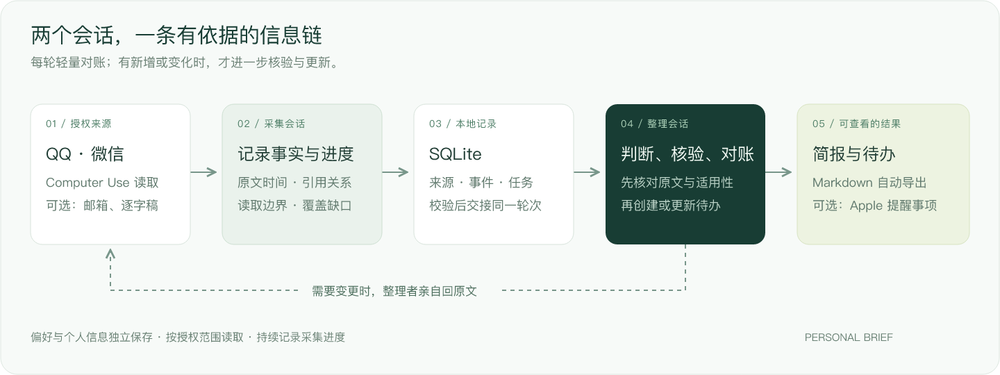

<div align="center">


**用 Computer Use 读取 QQ、微信，把重要消息整理成待办。**

[快速开始](#快速开始) · [如何工作](#如何工作) · [读取与更新](#读取与更新) · [配置与数据](#配置与数据) · [开发与验证](#开发与验证)

</div>

Personal Brief 是一个面向 AI Agent 的 Skill。让你已有的 Agent **通过 Computer Use 阅读授权的 QQ、微信会话**，找出需要关注的通知，核对原文和截止日期，再维护个人简报与待办事项。

支持按联系人、群聊和时段增量读取，也可接入只读邮箱与本地录音逐字稿。你决定关注范围，Agent 负责筛选事项、核对日期和更新状态。

> **v0.1.3** · 当前试运行环境：Codex + macOS。已验证来源采集、原文核验、提醒写入与零新增对账。

## 为什么做这个

| 消息里的问题 | Personal Brief 的处理方式 |
| --- | --- |
| 群通知很多，真正要做的事容易被淹没 | 按本人背景和偏好筛选，区分必办、可选、待确认 |
| 引用了一条旧消息，“明天”到底是哪天？ | 区分原消息日期、转发日期和当前正文，回原文核对 |
| 同一事项被多个群重复通知 | 合并来源，维护一项待办 |
| 通知改期了，或你已经做完了 | 更新状态，尊重用户手动完成、删除和修改 |
| 不想每次从头翻聊天记录 | QQ 比较已核对的列表快照，未变化跳过正文；变化或歧义才进入核对 |

## 如何工作



**一个 Skill，两个分工明确的会话。**

1. **采集**：读取授权范围的 QQ、微信；可选读取邮箱和逐字稿。只记录事实、原文依据、来源日期和已读到的位置。
2. **整理**：每轮先核对现有待办。有新增或变更时，判断适用性、合并事项，并亲自回原始来源复核后再写提醒。
3. **生成与保存**：整理 Agent 生成简报，保存到 SQLite 数据库后导出为 Markdown。原文、判断与缺口可追溯。

正式使用可固定复用两会话：一个采集定时入口，完成交接后唤起同一个整理会话。每轮轻量对账，有变化时处理受影响的事项。模型、调度与 Computer Use 由宿主提供。

[查看虚构简报示例 →](examples/brief.md)

## 读取与更新

| 配置项 | 工作方式 |
| --- | --- |
| 关注范围 | 指定会话名单、数量上限、回看范围和读取时段 |
| 界面读取 | 通过 Computer Use 查看 QQ、微信会话，记录原文与时间 |
| 未读标记 | 原本未读的会话读后恢复标记，并记录恢复结果 |
| 提醒更新 | 核验后写入指定列表，尊重用户的完成、删除和修改 |
| 运行状态 | 登录失效、锁屏或权限不足时记录缺口，保留上次成功进度 |

操作权限在 [Skill](skills/personal-brief/SKILL.md) 中定义，读取范围和提醒规则由私人配置控制。

## 快速开始

需要 Python **3.9+**，以及能访问你本机 QQ / 微信界面的 Computer Use 宿主。Apple 提醒事项和 macOS 钥匙串邮箱是可选适配；缺少待办写入能力时，可先只输出 Markdown。

### 1. 安装完整 Skill 文件夹

下载本仓库，或运行：

```sh
git clone https://github.com/qkycir/personal-brief.git
cd personal-brief
```

将 `skills/personal-brief/` 复制到宿主支持的技能目录。以 Codex 为例，目标通常为 `~/.codex/skills/personal-brief/`。若已有同名安装，先比较版本，不覆盖私人数据或正在使用的文件。

Skill 内包含全部运行辅助脚本与模板，复制整个文件夹即可。使用其他 Agent 时，按宿主说明配置技能目录与 Computer Use 能力。

### 2. 在仓库外建立私人数据目录

在仓库根目录运行以下命令；安装后也可以使用安装位置里的同名脚本：

```sh
python3 skills/personal-brief/scripts/init_private.py \
  --data-dir "$HOME/.local/share/personal-brief"

python3 skills/personal-brief/scripts/brief_store.py \
  --data-dir "$HOME/.local/share/personal-brief" init
```

初始化会生成私人配置模板。填写关注范围、启用所需来源后，即可开始手动采集；已有配置会保留。

### 3. 填写私人输入

| 文件 | 填什么 |
| --- | --- |
| `config.md` | 路径、时区、宿主模型、固定会话绑定、提醒适配器 |
| `preferences.md` | 允许读取哪些群或联系人、数量上限、时段、筛选和提醒偏好 |
| `个人信息.md` | 你愿意提供、用于判断通知适用性的背景；未知项留空或待确认 |
| `user-facts.md` | 可选：你明确确认的完成状态或纠正，避免旧要求再次变成待办 |

个人信息用于判断通知适用性，偏好决定读取范围。用户填写的资料与整理 Agent 生成的背景摘要分别保存。

### 4. 先手动跑通，再启用定时

把下面的提示词交给你的 Agent，并填入真实私人目录：

```text
使用 $personal-brief，为我检查私人数据目录中的配置。
先说明可用的 Computer Use、存储和提醒能力。
只读取我在 preferences.md 中明确启用的来源。
按两阶段流程进行一次采集和独立核验，严禁发送消息。
暂不创建定时任务。
```

采集和整理的完整提示词分别见 [collect-session.md](skills/personal-brief/references/collect-session.md) 与 [organize-session.md](skills/personal-brief/references/organize-session.md)。确认结果准确后，再按 [scheduled-session.md](skills/personal-brief/references/scheduled-session.md) 绑定两个固定会话和单一定时入口。

邮箱连接、系统钥匙串配置和提醒适配详见 [setup.md](skills/personal-brief/references/setup.md)。

## 配置与数据

```text
公共仓库                         私人数据目录（仓库外）
├── skills/personal-brief/        ├── config.md
│   ├── SKILL.md                  ├── preferences.md
│   ├── references/              ├── 个人信息.md
│   ├── scripts/                 ├── user-facts.md
│   └── templates/               ├── brief.sqlite3
├── docs/assets/                 ├── events.md / tasks.md / focus.md
├── examples/                    ├── runs/ 与原始证据缓存
└── tests/                       └── mail-accounts.json（无密码）
```

公共仓库保存通用规则、辅助代码、空白模板和虚构示例。个人资料、偏好、消息记录与会话绑定保存在仓库外的私人目录。

整理 Agent 负责生成简报和背景摘要，内容保存到 SQLite 数据库后导出为 Markdown；事件清单、采集进度和待办账本则由工具根据数据库记录生成。私人输入由用户维护，动态状态通过存储工具更新。数据结构见 [storage.md](skills/personal-brief/references/storage.md)。

截图和消息摘录由所选 Agent / 模型服务处理，数据使用遵循宿主与模型设置。本地 SQLite 文件采用普通文件存储，账号凭据使用系统钥匙串等安全存储。

## 开发与验证

```sh
python3 -m unittest discover -s tests -v
python3 scripts/check_public.py
```

测试使用虚构消息和临时目录，覆盖事务回滚、重复事件、引用日期、任务完成保护、邮件只读访问和独立安装。

接入实际客户端后，按配置验收界面读取、来源覆盖、未读恢复和通知送达。定时运行需要宿主与电脑保持可用。

## 许可证与状态

许可证：[MIT](LICENSE)。配图为本仓库原创 SVG，附 PNG 预览。安装包见 [Releases](https://github.com/qkycir/personal-brief/releases)。
